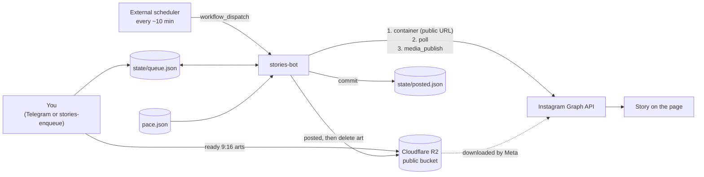

# Peixoto Variedades — Instagram Stories Queue


A bot that publishes **dozens of Instagram Stories a day from a product queue** for the page *Peixoto Variedades*. It uses the official **Instagram Graph API**, stores the arts on **Cloudflare R2** and runs on **GitHub Actions**: no server, no paid scheduler.

It shares its core with the restaurant bot (`O-Grande-Mestre-Posts`), but swaps the weekly schedule for a queue with a pacing rule.

🇧🇷 Passo a passo de configuração em português: [`docs/SETUP.pt-BR.md`](docs/SETUP.pt-BR.md)

## How it works



1. Arts (already 1080×1920) reach the queue: send them to the Telegram bot as **files**, or run `stories-enqueue` on a folder. Each art is uploaded to R2 and appended to `state/queue.json`.
2. On every run, `stories-bot` checks the **pace** (opening hours, minimum interval since the last Story, daily limit). If allowed, it publishes **exactly one** Story: the head of the queue.
3. The post is recorded in `state/posted.json`, removed from the queue and its art deleted from the bucket.

### Design decisions

| Decision | Why |
|---|---|
| Queue + pace instead of a weekly schedule | Dozens of products a day have no fixed times; they just need spacing. |
| One Story per run | GitHub's cron can run hours late. A late trigger delays Stories; it never dumps a backlog at once. |
| Arts on R2, not in git | ~30 arts a day would fill a repository; published arts are deleted from the bucket. |
| Idempotent recording | The post is recorded before it leaves the queue; a run that dies in between is healed on the next one (no double posts). |
| Poison-item protection | A Story failing 3 times goes to `state/failed.json` and the queue moves on. An expired token (Graph error 190) stops the run instead, so it cannot drain the queue. |
| Credentials only in environment variables | Errors never include request URLs, so tokens cannot leak into logs. |

## Pace (`pace.json`)

```json
{
  "timezone": "America/Sao_Paulo",
  "days": ["mon", "tue", "wed", "thu", "fri", "sat"],
  "start": "09:00",
  "end": "21:00",
  "interval_minutes": 60,
  "daily_limit": 12,
  "low_queue": 10,
  "notify_each": false
}
```

| Field | Meaning |
|---|---|
| `days` | Weekdays (`mon tue wed thu fri sat sun`) on which Stories go out. Default: every day. |
| `start` / `end` | Stories only go out inside this local window. |
| `interval_minutes` | Minimum gap since the last Story. With a 10-minute trigger the real gap is 20–30 min. |
| `daily_limit` | Max Stories per local day (Instagram allows 100 API posts per 24 h; the cap here is 90). |
| `low_queue` | Telegram alert when this many Stories are left (and another when the queue runs out). |
| `notify_each` | Also message on every published Story (off by default: dozens a day is noisy). Failures always notify. |

## Adding arts

**Telegram (optional, recommended).** With `TELEGRAM_BOT_TOKEN` and `TELEGRAM_CHAT_ID` set, send arts to the bot as **files** (paperclip → File, so Telegram does not compress them). Several at once is fine; the bot answers with one summary per run.

| Message | Effect |
|---|---|
| art file | goes to the end of the queue |
| art file with caption `primeiro` | jumps to the front |
| `/fila` | queue size and the next 10 |
| `/remover N` | removes item N of `/fila` from the queue and the bucket |

Only the private chat whose id is `TELEGRAM_CHAT_ID` is obeyed; anyone else is ignored without a reply. Telegram keeps unread messages 24 h and lets bots download files up to 20 MB.

**Command line.** For a big batch from a folder (needs the `R2_*` variables, see `.env.example`):

```bash
stories-enqueue arts/            # a folder, or individual files
stories-enqueue promo.jpg --front
```

Then commit `state/queue.json`.

## Quick start

```bash
python -m venv .venv && source .venv/bin/activate   # Windows: .venv\Scripts\Activate.ps1
pip install -e ".[dev]"
pytest                                              # tests
stories-bot --dry-run --now 2026-10-09T10:00        # preview the next Story
```

## Setup

See [`docs/SETUP.pt-BR.md`](docs/SETUP.pt-BR.md). In short:

1. Instagram Professional account linked to a Facebook Page; Meta app; `stories-token` prints `IG_USER_ID` and a ~60-day `IG_ACCESS_TOKEN`. Without a Page, use the **Instagram Login** mode instead: `stories-token-ig` and the repository variable `IG_API=instagram` (see the setup guide).
2. Cloudflare R2 bucket with public access and an S3 API token.
3. GitHub repository with the secrets: `IG_USER_ID`, `IG_ACCESS_TOKEN`, `R2_ACCOUNT_ID`, `R2_ACCESS_KEY_ID`, `R2_SECRET_ACCESS_KEY`, `R2_BUCKET`, `R2_PUBLIC_URL`, and optionally `TELEGRAM_BOT_TOKEN`, `TELEGRAM_CHAT_ID`.
4. An external scheduler (cron-job.org) calling `workflow_dispatch` every ~10 minutes, because GitHub's own cron is not punctual.

> **Token renewal:** the long-lived token expires after ~60 days. When it does, the bot stops, sends a Telegram alert and keeps the queue intact. Run `stories-token` again and update the `IG_ACCESS_TOKEN` secret.

## Limitations

- The API cannot add interactive stickers (link, poll, mention): put any text inside the art.
- Keep the repository **public**: it only holds the queue (file names), and public repositories get unlimited Actions minutes, which a 10-minute trigger needs.
- GitHub pauses scheduled workflows after 60 days without repository activity; here every post commits, so that does not happen while the queue is in use.

## Project layout

```
src/stories_bot/
  pace.py         pacing rules: hours, interval, daily limit
  story_queue.py  the queue: add, remove, give up on poison items
  storage.py      Cloudflare R2 (S3-compatible) client
  instagram.py    Graph API client (container → poll → publish)
  state.py        atomic record of published Stories
  inbox.py        receive arts from Telegram, /fila, /remover
  inbox_cli.py    `stories-inbox` entry point
  enqueue_cli.py  `stories-enqueue` entry point (bulk upload)
  cli.py          `stories-bot` entry point
  notify.py       Telegram alerts
  telegram.py     Bot API client (token never reaches logs)
  media.py        PNG/JPEG size check for the 9:16 warning
  config.py       environment-based settings
  token_setup.py  `stories-token` helper (Page-linked accounts)
  ig_token.py     `stories-token-ig` helper (Instagram Login, no Page)
tests/            pytest suite (HTTP and storage mocked)
.github/workflows/
  ci.yml          ruff, mypy, pytest on Python 3.10–3.12
  stories.yml     queue intake + publisher
```

## Development

```bash
ruff check . && ruff format --check .   # lint + formatting
mypy                                    # strict type checking
pytest                                  # tests + coverage
```

## License

[MIT](LICENSE) © Pedro Henrique de Almeida Peixoto
